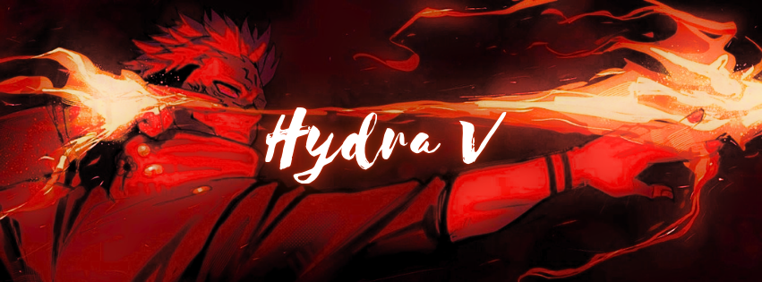

  

  # HYDRA V
  **Creative Developer & Digital Tinkerer**

  
  
  
  

---

### `> whoami`

Personal sandbox where I build tools to scratch my own creative itches — from workflow automation and productivity web apps to audio-reactive visuals and game experiments.

- **Building:** Automation scripts, audio visualizers, web apps & game dev prototypes
- **Exploring:** Creative coding, FFT audio analysis, shaders & low-level systems
- **Off-screen:** Video editing, streaming, electronic/hardcore music production & live coding (Strudel / Hydra)
- **Main academic & pro portfolio:** [charles-mailliot.github.io/Portfolio](https://charles-mailliot.github.io/Portfolio/)

---

### `> tech_stack`

  
  
  
  
  
  
  

---

### `> activity`

  
  

